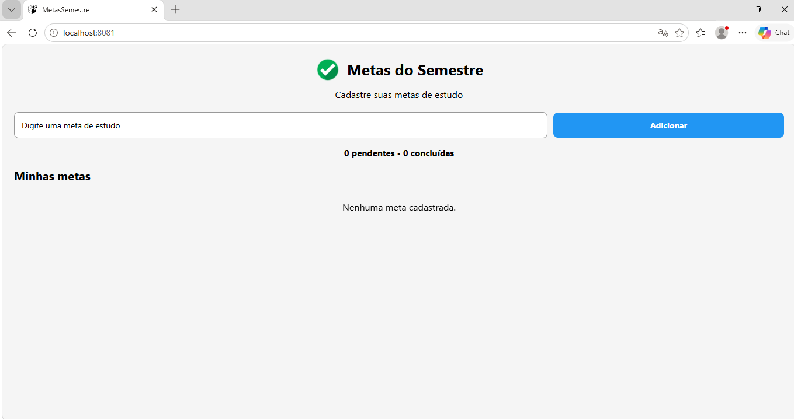

# MetasSemestre

Aplicativo desenvolvido em React Native com Expo para cadastro e gerenciamento de metas de estudo do semestre.

## Objetivo

O aplicativo permite:

- Adicionar metas de estudo;
- Validar o preenchimento da meta;
- Excluir metas;
- Marcar metas como concluídas;
- Visualizar a quantidade de metas pendentes e concluídas;
- Manter as metas salvas mesmo após fechar e abrir o aplicativo.

## Tecnologias utilizadas

- React Native
- Expo
- JavaScript
- useState
- useEffect
- Pressable
- AsyncStorage
- SafeAreaContext
- FlatList

## Componentização

O aplicativo foi dividido em componentes para facilitar a organização e manutenção do código.

### MetaInput

Responsável pelo campo de texto e pelo botão de adicionar uma nova meta.

### MetaList

Responsável por exibir as metas cadastradas, permitir a conclusão e a exclusão das metas.

## Persistência dos dados

Foi utilizado o AsyncStorage com a chave:

`@metas_semestre`

Um `useEffect` é executado quando o aplicativo inicia para carregar as metas armazenadas.

Outro `useEffect` acompanha a lista de metas e salva os dados sempre que ela é alterada.

Os dados são convertidos para JSON antes de serem armazenados e convertidos novamente para objeto ao serem carregados.

## Validação

O aplicativo não permite cadastrar uma meta vazia. Caso o usuário tente adicionar uma meta sem preencher o campo, uma mensagem de alerta é exibida.

## Evidências

### 1. Aplicativo sem metas

### 2. Aplicativo com metas cadastradas

### 3. Meta concluída

### 4. Persistência dos dados

Após fechar e abrir novamente o aplicativo, as metas permanecem cadastradas devido ao uso do AsyncStorage.

